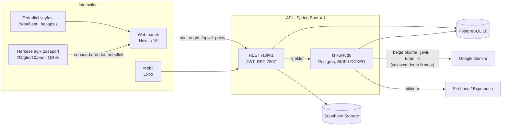
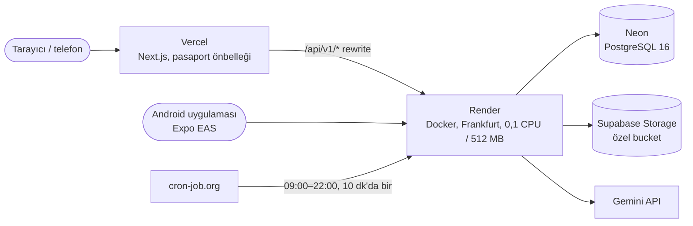
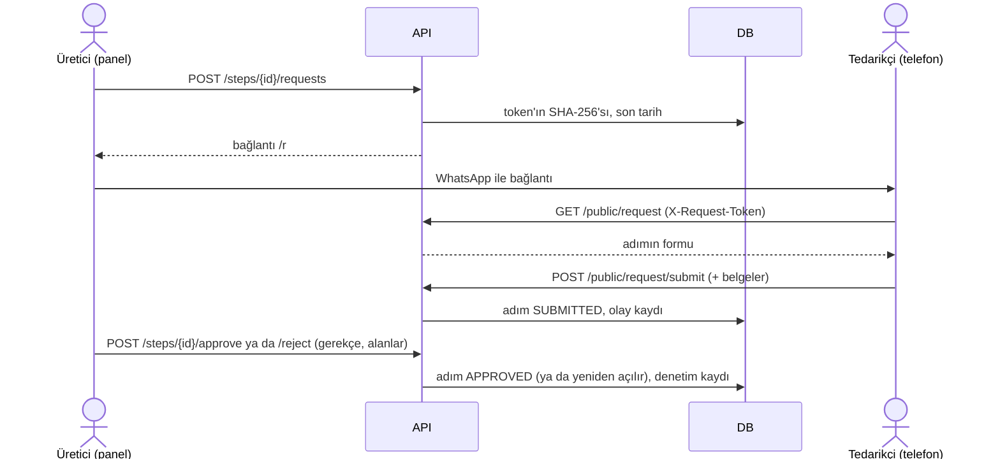
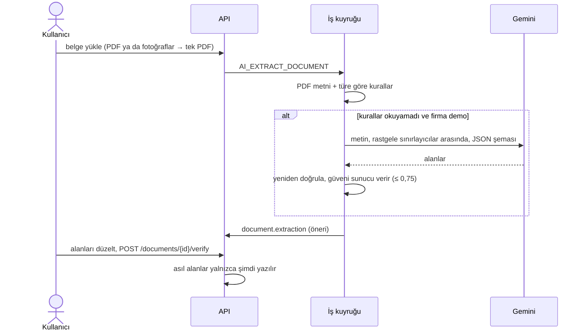
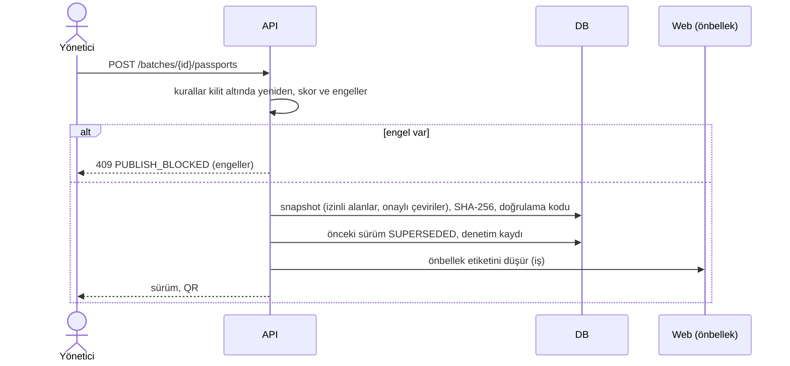

# Mimari

## 1. Sistem

## 2. Dağıtım

Hepsi ücretsiz katman. Render'ın ücretsiz servisi 15 dakika trafiksizlikte uyur; cron gün içinde uyanık tutar, web "sunucu uyanıyor" durumunu gösterir.

## 3. Tedarikçiden veri toplama

## 4. Belge okuma (AI önerir, insan onaylar)

## 5. Yayın

